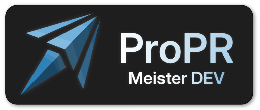

<p align="center">
  
  <br>
  <em>AI code review for Azure DevOps, GitHub, GitLab, and Forgejo</em>
</p>

<p align="center">
  <a href="https://github.com/meister-dev-ai/propr/actions/workflows/ci.yml"></a>
  <a href="LICENSE"></a>
  
  <a href="https://techcommunity.microsoft.com/blog/azure-events/announcing-the-ai-dev-days-hackathon-winners/4513528"></a>
</p>

---

ProPR reviews your pull and merge requests with AI, on the SCM host you already use. It reads the
changed files, comments on specific lines, and posts a summary, either automatically as pull
requests come in or on demand from CI.

## What we care about

- **Your code stays where it is.** Reviews run against Azure DevOps, GitHub, GitLab, and
  Forgejo-family hosts. ProPR reads each repository in place.
- **Your AI, your keys.** Bring your own model: Azure OpenAI / AI Foundry, OpenAI, Anthropic, AWS
  Bedrock, Google Gemini and Vertex AI, a LiteLLM gateway, or any OpenAI-compatible endpoint you point
  it at, including ones you host yourself. ProPR ships no model of its own and sends your code only to
  the endpoint you configure.
- **Self-hosted.** You run the whole stack. Provider and AI credentials are scoped per client and
  protected at rest.
- **Every decision is on the record.** Reviews, AI calls, tool calls, filter decisions and timing are
  stored, and the management UI shows them. Verification-withheld findings remain internal evidence;
  enabled Code Insights collection records their nonpublication without assigning outcome credit.
- **Tuned for cost and relevance.** Token-aware reviews, per-file passes and relevance filtering limit
  what a review sends to the model and what it posts back.

## Get started

The example Docker Compose stack in this repository is the fastest way to start. Clone the repository,
copy the example environment file, and fill in the four required values the
[quickstart](docs/quickstart.md) lists.

```bash
git clone https://github.com/meister-dev-ai/propr.git
cd propr
cp example/docker-compose/.env.example example/docker-compose/.env
# edit example/docker-compose/.env
cd example/docker-compose
docker compose up --build
```

That builds the three ProPR images from the checkout. To run the published release images instead, see
[Running published images](docs/operate/deploy.md#running-published-images).

The [quickstart](docs/quickstart.md) covers the requirements, where to sign in, connecting your first
provider and AI model, and getting a first review posted. The [deployment guide](docs/operate/deploy.md)
covers what to change once you keep the installation. The compose stack is for evaluation;
`example/azure/.azure/` deploys the same stack to Azure Container Apps.

Guided crawl, webhook, mention and ProCursor configuration starts with a saved client connection.
The connection supplies its accessible scopes, native hierarchy and source capabilities. ProCursor
knowledge-source creation is available for connections with a registered knowledge-source capability.

Active review admission leaves resolution-memory generation pending for the durable discussion worker.
Completed memory processing survives interrupted refreshes; final close evidence still requires the
discussion consumers to complete. See [discussion synchronization](docs/operate/discussion-synchronization.md).

## Documentation

Open a pull request from **Reviews** to inspect its review history, discussion, and retained diffs. The
**Browser** tab fills the content area with independently scrolling file and diff panes, file search, and
finding filters. See [the PR review screen](docs/concepts/reviews.md#pr-review-screen).

Findings carry impact, occurrence likelihood and correctness confidence with supporting reasons. ProPR derives risk severity
independently of the Error, Warning, Suggestion or Info classification. Review screens, Code Quality and
Code Insights use the same assessment; missing evidence remains Unassessed. Published findings start with
severity, risk, impact, likelihood and confidence badges, then finding types and the description. Each client
chooses Image badges (Shields.io), the default, or Plain gray badges under Post configuration. Plain badges
use inline code without external image requests. Assessment details
expand to show the full evidence table. ProPR starts review summaries with a **Fix first** entry for the highest
assessed confirmed defect, followed by the conclusion, finding excerpts ordered by risk and totals for findings
offered to the provider. Ties preserve the recorded finding order. Error means a confirmed defect; Suggestion means a
concrete improvement. A file's investigation confidence does not change that classification.

Published correctness confidence comes from independent verification evidence. Generated confidence is provisional.
Source quotes must cover complete substantive lines; fragments do not establish confidence. A negative verdict
removes a claim only with grounded counterevidence; otherwise the claim remains unresolved.
Certain requires a source-grounded trigger, consequence and resolved counterevidence, followed by a separate bounded
contradiction check. The same check runs for every confirmed Error or Warning, for a confirmation after the verifier's
last repository lookup and for a finding that states its trigger is not established. When the check does not confirm
such a finding, the check's verdict decides its publication. A confirmed Error or Warning that would still be published
at Medium or below, or Unassessed, goes to a second check on the High effort model. Missing confidence metadata leaves
an otherwise supported finding Unassessed. Synthesis can challenge a retained finding by stable ID; ProPR resolves that
challenge before publishing the claim.

The review assigns finding types such as Logic error, Concurrency and Security from the fixed taxonomy and any
active client custom types while producing each finding. Code Insights uses that same classification, including
code level, qualifier and separate numeric type confidence. Historical or unclassified findings retain bounded
background classification. Missing type metadata never removes a finding.
Per-file passes, including inventory passes, use the captured vocabulary. Synthesis preserves the types of
unchanged findings and combines the supported types of explicitly identified source findings. The quality filter
identifies retained or reworded findings by source IDs, preserving their classification and evidence.
Combined findings retain the highest supported source risk and confidence no stronger than their weakest material
source. Incompatible replacements keep the original findings.

When evidence supports an exact local replacement, Azure DevOps, GitHub and GitLab comments offer an applicable
suggestion for the validated source range and revision. Forgejo displays the proposed replacement under
**Suggested change** in an ordinary code block. ProPR uses the same format when source evidence is missing or
stale or the anchor is unsuitable. Supported source languages enable syntax highlighting. ProPR retains findings
independently of fix availability. See [finding risk](docs/concepts/reviews.md#finding-risk).

All documentation is under [docs/](docs/index.md), which maps every page and gives a reading order.
Start at one of these:

| Document | Read it when |
|---|---|
| [Quickstart](docs/quickstart.md) | You want ProPR running on one machine, with one review posted on a real pull request |
| [How it works](docs/concepts/how-it-works.md) | You want to know what you deployed and how a review gets triggered |
| [Reviews](docs/concepts/reviews.md) | You need to know what happens inside a review, or why a finding was not posted |
| [Reviewer performance](docs/concepts/reviewer-performance.md) | You want score ranges over covered pull requests, qualified model recall/F1, overall precision, evidence recovery, or saved reports |
| [SCM platforms](docs/platforms/index.md) | You are connecting Azure DevOps, GitHub, GitLab or Forgejo, on-prem included |
| [AI providers](docs/ai/index.md) | You are choosing a model provider, or deciding between a native family and a gateway |
| [Deploying](docs/operate/deploy.md) | You are past evaluation and need ingress, images, workers and persistence configured |
| [API reference](docs/reference/api.md) | You are scripting setup, or triggering reviews from CI |
| [Security](docs/reference/security.md) | You are reviewing where code goes, secrets, sessions, and tenant isolation |
| [Editions](docs/reference/editions.md) | Something is refused and you suspect it needs a commercial license |
| [Usage statistics](docs/reference/usage-statistics.md) | You need the field-by-field payload of the daily report, and how to switch it off |
| [Code Insights architecture](docs/architecture/code-insights.md) | You need the analytics evidence, projection, authorization and report ownership boundaries |

SCM contract and adapter ownership is documented in [SCM provider boundaries](docs/architecture/scm-provider-boundaries.md).

## License

ProPR is distributed under the Elastic License 2.0. Some features in the tree require a commercial
license to activate or use, self-hosted deployments included.

- [LICENSE](LICENSE) - repository-wide source license
- [LICENSING.md](LICENSING.md) - how source files are marked, and what a marking means
- [COMMERCIAL.md](COMMERCIAL.md) - when a commercial license is required
- [COMMERCIAL-LICENSE-POLICY.md](COMMERCIAL-LICENSE-POLICY.md) - which installations one license may be activated on
- [SECURITY.md](SECURITY.md) - reporting vulnerabilities
- [CONTRIBUTING.md](CONTRIBUTING.md) - how to contribute
