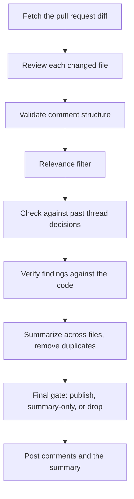

# Reviews

This page covers what happens inside one review, and every setting that changes what it publishes. What a
deployment is made of and how a review gets started is on [how ProPR works](how-it-works.md). The two settings that
live in the repository, not in ProPR, are on
[configuring ProPR from your repository](repository-configuration.md).

## PR review screen

Open a pull request from **Reviews**. The toolbar contains **Back to reviews**, the pull request number,
and the **Stats**, **Conversation**, **Browser**, and licensed **Code Quality** tabs. Stats shows review
jobs, thread passes, tokens, costs, and memory records.

Stats reads paged review summaries and up to 50 thread passes. Token totals use stored job usage, with
protocol totals supplying missing values. Memory details are limited to 50 originating and 50 contributing
records. The originating count includes all matching records. Full result and protocol bodies are available
through their detail views.

The Browser tab uses the available content height. The file list and diff scroll independently. Search
matches file names and paths without regard to case. Finding filters select files with findings, without
findings, or with comments. Code Insights adds filters for finding kind, classification, risk severity,
impact, likelihood, confidence and outcome. Combined filters require recorded details and must match the same finding. Filtering
preserves the selected diff while its file and retained revision remain in the list. Excluding the selected
file or replacing its retained revision clears the diff and comments.
**Clear filters** restores the file list. On narrow screens, **Files** opens the file pane and selecting
a file returns to the diff.

Retained user and ProPR comments appear next to their new-side lines in both Unified and Split layouts.
Comments whose lines are absent from the diff appear under **Unanchored comments** in the diff pane.
ProPR comments retain links to their originating review traces. When Code Insights collected metadata,
the original finding comment displays classification, risk assessment, classified kinds, outcome and a recorded rejection reason.
**Duplicate** means the recorded rejection reason is Redundant. Replies retain their own authorship and
are not assigned the original finding's classification.
Recorded thread IDs take precedence when matching comments to findings. Text matching can supply missing
provider identities but cannot override conflicting IDs. The Outcome filter matches recorded dispositions
and duplicate rejection reasons; a Dismissed finding rejected as Redundant appears under both selections.

Finding counts include recorded findings and AI-rooted retained threads without a matching record.
Repeated copies of the same retained thread count once. Threads with distinct recorded identities remain
separate observations even when their comment text matches.
When thread and comment IDs are unavailable, identical job, location, and text snapshots count once;
different locations or messages remain separate observations.

Finding details load when Browser opens and refresh when review history changes. The last successful details
for the same pull request remain visible with the loading or failure notice during a refresh. A failed metadata
read leaves the diff and discussion available and offers **Retry**. Retention settings determine which files
and comments are available; see
[raw PR data retention](../reference/security.md#what-propr-stores).

An actionable license stage appears as a warning button in the application header. Open it for the expiry
or grace-period message and the licensing link. On the PR view, other installation notices also open from
the header. Escape or an outside click closes the disclosure.

## Finding risk

Each assessed finding carries three independent judgments and their reasons:

| Dimension | Values and meaning |
|---|---|
| Impact | Low: local inconvenience or maintenance cost. Moderate: bounded disruption. High: substantial service, security, data or maintenance harm. Critical: catastrophic service, security or data harm. |
| Likelihood | Unlikely: exceptional conditions. Possible: plausible conditions. Likely: routine conditions. The reason identifies the trigger or exposure. |
| Confidence | Low: limited evidence with substantial assumptions. Medium: supporting evidence with relevant assumptions. High: strong evidence with minor uncertainty. Certain: direct deterministic evidence without relevant unresolved assumptions. The reason identifies evidence and remaining assumptions. |

Likelihood describes the occurrence scenario. Finding confidence describes the strength of evidence that the finding is
correct. It is independent of the numeric investigation, verification and classification confidence values. A confirmed Error can have Low risk when its consequence and exposure are limited. Maintenance
findings use a concrete editing or operational scenario. Unknown means evidence is insufficient;
Not applicable means there is no meaningful occurrence scenario.

The `finding-risk-v1` rubric derives risk severity from impact and likelihood:

| Impact | Unlikely | Possible | Likely |
|---|---|---|---|
| Low | Low | Low | Low |
| Moderate | Low | Medium | Medium |
| High | Medium | High | High |
| Critical | High | High | Critical |

Missing dimensions, reasons or provenance, unsupported rubric versions and Not applicable likelihood
produce Unassessed risk. Known dimensions remain visible. Historical findings and output from custom
prompts that omit assessments remain Unassessed; ProPR does not infer their risk from classification.

ProPR resolves fresh correctness confidence from independent verification evidence. The generating model's assessment
is provisional: verification can confirm or lower its confidence, not raise it. The verifier provides a reachable input
or state sequence, its observable consequence, exact source excerpts and an explanation of relevant counterevidence.
Certain requires complete evidence without unresolved material assumptions and a separate bounded contradiction check.
ProPR runs the same check for every Error or Warning that the verifier confirms, for a confirmation after the verifier's
last repository lookup, and for a finding that states that its trigger is not established. The last two conditions
remain on the finding as assumptions and limit its confidence to Medium. The check uses the configured Low effort
model, the verifier's repository lookups and its own time limit. A confirmed Error or Warning that would be published
at Medium or below, or Unassessed, goes to a second check on the configured High effort model. Each check uses the
reviewer runtime when its purpose is unavailable, recording the fallback.

Missing or malformed confidence evidence leaves a supported finding Unassessed and preserves its impact, likelihood
and classification. A check that fails, times out or answers unusably bounds confidence without removing an
independently supported finding. A check that answers with another verdict than a confirmation gives the finding the
disposition that verdict has for the verifier, so a claim the check finds not actionable or intended moves to the
summary. Source refutation removes the false claim. A confidence reason states the witness and the consequence first,
then the counterevidence and the unresolved assumptions. A reason longer than 1,024 characters ends after its last
complete sentence within that length. When no sentence ends after the first 512 characters, the reason ends after its
last complete word, followed by an ellipsis. A combined finding cannot inherit stronger confidence from a single
selected source. Historical carried-forward assessments retain their recorded values.

Synthesis requests reconsideration with a retained finding ID, a specific doubt and counterevidence. ProPR verifies each
challenged finding once, retaining the original producing pass's repository access and structured patch. A finding
whose challenge stays unresolved becomes summary-only; a refuted claim is excluded from inline comments and verified
summary claims.

Published findings start with severity, risk, impact, likelihood and confidence badges, followed by all
supported finding types. The original description
appears in its own paragraph. Under a client's **Post configuration**, **Finding badges** selects
**Image badges (Shields.io)**, the default, or **Plain gray badges**. Images use the flat-square style with
risk colors, blue finding types and gray severity and other assessments. Image alternative text describes
each value. Plain badges use inline code without requesting external images. The choice applies to all SCM
providers and complete findings included in summaries.

Assessment details expand to show a table with Assessment, Level and Reason columns and separate Risk,
Impact, Likelihood and Confidence rows. Risk states its derivation from impact and likelihood; the other rows
retain their recorded reasons. Findings without an assessment show severity, available finding types and description.

Review summaries preserve the conclusion, list findings with their recorded descriptions and locations,
and show a compact table of findings to report, risk levels and confidence levels. These counts describe
findings offered to the provider after publication policy evaluation. Provider deduplication or individual
posting failures can reduce the number posted. Missing evidence has an Unassessed bucket; an empty set
shows zero findings and None for both distributions. Compact actions show up to 20 findings with
320-character description excerpts and 160-character path excerpts; Unicode scalars remain intact.
Compact action text is limited to 8,000 characters. An omission notice reports any additional actions;
totals still count every offered finding. Complete finding comments retain their original descriptions.
PR-level findings included in a summary use the same complete finding layout, including expandable
assessment details.

Review traces and retained finding details show the same evidence. Code Quality provides risk
distributions and independent filters for each dimension. Reviewer Performance supports those filters,
series and matrix axes; [its evidence limits](reviewer-performance.md#evidence-limits) explain score availability.

ProPR starts review summaries with a **Fix first** entry for the highest assessed confirmed defect before the
conclusion. The entry requires a confirmed defect with scored risk and uses the first recorded defect when
several share that risk. ProPR orders finding actions by risk with stable ties. The stored comment order and
publication ordinals do not change. Findings without a scored assessment remain Unassessed.

Exact local fixes are optional. A fix specifies complete original and replacement lines in one contiguous source
range, bound to the reviewed file and revision. Azure DevOps and GitHub publish matching native ranges; GitLab
uses explicit offsets around its new-side comment line. Forgejo displays the replacement under
**Suggested change** in an ordinary code block, with syntax highlighting for supported source languages.
Structured fixes with unknown or stale source or an unsuitable anchor use the same labeled format.
Unvalidated suggestion fences remain ordinary code.
An original and replacement that are identical after line-ending normalization produce no suggested-change block.
ProPR retains the finding and records the rejected patch independently. Indentation and internal whitespace remain
significant when comparing code.
The same finding remains available when no applicable fix can be offered. Code characters and indentation are
preserved. Review and synthesis guidance asks for concrete evidenced inputs, configurations or call paths,
keeps unverified preconditions explicit, and prevents a summary from strengthening its source claims.

Error means a confirmed defect, Warning means evidence of a defect with unresolved context, and Suggestion
means a concrete improvement. A confirmed defect remains Error when its risk is low; aggregate file investigation
confidence cannot change it into an improvement. Verification promotes a finding only when it explicitly
confirms a defect; confirmation of an actionable improvement preserves its improvement classification.

Error, Warning, Suggestion and Info remain the finding classification. Minimum classification to post
uses that classification. Risk assessment does not change verification, publication thresholds or
thread resolution policy, and Low risk does not discard a finding.

## What happens during a review

**Per file.** ProPR reviews each changed file separately, in parallel, each in its own conversation with
the model. It skips files matched by the repository's [exclusion patterns](repository-configuration.md),
and files whose estimated input would not fit the model's context budget. Both skips are recorded in the
job protocol.

**Relevance filtering.** ProPR screens the model's comments before they reach your pull request.
Deterministic checks run first, and a second model call decides the ambiguous ones. If that call fails,
the filter keeps the comment and records that it ran degraded.

**Thread memory.** ProPR remembers how a comment thread on this pull request was resolved, so a point you
already rejected does not come back on a later review. Each memory records the resolution: you rejected
the concern and kept the code, or you marked it fixed. A rejection carries more weight than a fix when the
same point comes up again, and a rejection the discussion never stated plainly carries less. Memories
recorded before ProPR tracked resolutions, and memories an administrator created by dismissing a pattern,
carry no resolution at all.

**Verification.** ProPR checks findings against the code before publication, once per file and again
across the whole pull request for anything that spans files. Both checks use the same judge, and a finding the judge
does not confirm is not posted. Per file, a judge on the low-effort model reads
the code at each finding, together with short excerpts that contain the symbols the finding names: from the files the
reviewing pass read, and from the same file outside the shown code. It decides four things: whether the finding is true, whether it leads to a concrete wrong
outcome, failure or maintainability defect that the author would fix, whether the pull request states the behaviour as
intended, and whether intended behaviour contradicts other functionality. Every
finding of every per-file review pass from which ProPR extracts a claim reaches the judge unless a known invariant
already contradicts it. Before it decides, the judge can make up to four read-only lookups in the repository: read a
file, search the code, or find references or a definition. Each finding therefore costs one to five model
calls, plus at most one output-budget retry. The judge requests `low` reasoning effort when the bundled
catalog advertises it for the exact model and the selected transport supports it. Other models, unknown
aliases and raw fallback clients use provider defaults. This decision is independent of the logical
model's configured effort. The initial output ceiling is 4,000 tokens, including reasoning. An
output-limit response or an unusable verdict whose measured output reaches the ceiling receives one
8,000-token retry. The retry retains completed lookups, allows no further lookups, and shares the claim's
120-second deadline. The job protocol records each lookup in an `evidence_judge_tool_call` event and each
exhausted output budget in an `evidence_judge_output_limit` event. Both attempts contribute to token usage.
The ceilings are [installation settings](../operate/configuration.md#evidence-judge-budgets).
The judge can also answer that the code it needs to decide is not in
its input. ProPR then publishes the finding if the pass that produced it read the repository with tools, and withholds
it if the pass had no tools. The inventory lens reviews without tools. A finding from which ProPR extracts no claim is withheld
without a verdict. ProPR reads the verdict from the JSON object in the judge's answer. If the end of that object is
damaged, for example by a stray quotation mark after the last quoted source line, ProPR reads the members before the
damage. When the judge cannot run, runs out of time or gives an unusable answer, the finding is withheld, and the
job protocol records a `verification_degraded` event for the file with the number of affected findings and the
reasons. Exhausting the retry records `judge_output_limit`. If the judge could decide none of a file's findings,
the file summary states that verification could not run. The job protocol records the verdict, the reason
and the line for each finding. Withheld findings retain their original comment, producing model and reason
as internal evidence, separately from publication candidates. Per-file checkpoints preserve that evidence
across job recovery, and completed job results retain final withheld evidence. Enabled Code Insights
collection includes it in withheld counts without assigning publication or precision credit.

After verification, ProPR merges findings that describe the same defect at nearly the same line. The job
protocol records each merge in a `finding_deduplication` event with the kept finding and the removed ones.

On a runner, the judge runs on the default model the job manifest names, because a runner has no low-effort
binding, and its tokens are reported against the default model.

**Incremental reviews.** On a re-review, files with no new changes carry their previous results forward
instead of being re-reviewed and re-billed.

Review history, duplicate detection and incremental result reuse are scoped to each client.
Manual review of an unchanged completed revision remains available.

## Why a finding did not get posted

A deterministic gate runs last, before publication. Every finding ends as **published**, **summary-only** or
**dropped**. A summary-only finding stays in the ProPR review without an inline comment, and the published summary
lists it when the pass that produced the finding wrote a summary line for it.

| Outcome | Applies to |
|---|---|
| Dropped | Findings the verification step contradicted |
| Summary-only | Findings the per-file judge did not confirm, judged true but without a concrete consequence, found intended without contradicting anything, or could not judge |
| Dropped | Findings the gate classifies as non-actionable, and "consider …"-style suggestions |
| Dropped | Repeated-pass findings where the passes disagreed and nothing supported the claim |
| Summary-only | Cross-file findings without verified supporting evidence |
| Summary-only | Broad categories: architecture, documentation, test, UI, configuration, robustness |
| Summary-only | Anything whose verification was degraded or inconclusive |
| Published | Everything else |

Three per-client filters run after the gate, all of them in [what you can tune](#what-you-can-tune): the
**minimum classification to post**, whether findings outside the changed lines are posted, and whether outbound
SCM commenting is enabled at all. A finding the first two hold back stays in the ProPR review, and the
published summary reports how many were held back and why. The summary links to the review once
`MEISTER_PUBLIC_BASE_URL` gives the installation its address - see
[public URL and browser origins](../operate/configuration.md#public-url-and-browser-origins).

A dropped finding also has to leave the summary. ProPR writes the summary before the gate runs, so the
summary can describe a finding the gate then rules out. Where that happens, the synthesis model rewrites the
summary without the dropped findings in one more call. If that call fails, ProPR replaces the narrative with a
short note saying how many candidates were dropped.

The client dashboard's 30-day finding count uses findings in persisted completed review results whose
completion time is at or after the window start and before the window end. It does
not count SCM comments, so disabling comment posting does not remove reviewed findings from the metric.

The review's protocol records every one of these decisions - see
[what to look at when a review misbehaves](../operate/observability.md#what-to-look-at-when-a-review-misbehaves).

If your symptom is not in this section, start from [troubleshooting](../operate/troubleshooting.md).

## What you can tune

Everything below is set in the management UI. Unless noted, the scope is one client.

| Setting | Where | Effect |
|---|---|---|
| Logical model per purpose | Tenant or client | Which model does review generation, triage, verification and embeddings - see [purposes, effort and protocol](../ai/purposes.md) |
| Reasoning effort | Per logical model | Default effort for calls using that model; the evidence judge uses `low` when support is established - see [reasoning effort](../ai/purposes.md#reasoning-effort) |
| Baseline reasoning effort | Per client | Reasoning effort for the baseline review pass. `None` by default, which sends no reasoning effort at all and leaves cost unchanged |
| Review aggressiveness | Per client | `Calm`, `Balanced` or `Assertive`. Calm keeps only what passes the strictest certainty gate; Balanced adds design-level observations; Assertive keeps those and lets less certain findings through |
| Review temperature | Crawl and webhook configurations | More deterministic or more creative than the model default, `0.0`–`2.0` |
| Multi-pass union | Per client | Review higher-complexity files across several independent passes and union the findings before deduplication. Costs more per file |
| Review pass list | Per client | Which extra passes run, on which model, and with which lens - see [Review passes](#review-passes) |
| Output language | Per client | The language the review writes in - see [Output language](#output-language) |
| Linked work items and issues | Per client | Pulls the work items or issues linked to the pull request into the review context, so the change is judged against its intended direction. On by default |
| Exclusion rules | Per repository | Glob patterns read from the repository - see [configuring ProPR from your repository](repository-configuration.md) |
| Concurrent reviews | Per tenant | How many reviews of the tenant run at the same time. A platform administrator sets it - see [tenant review limits](#tenant-review-limits) |
| Maximum review duration | Per tenant | How long one review of the tenant runs before it ends with the files it has reviewed. A platform administrator sets it - see [tenant review limits](#tenant-review-limits) |
| Minimum classification to post | Per client | Findings below it stay out of the pull request but remain visible in the ProPR review, and the published summary reports how many were held back. Order, high to low: error, warning, suggestion, info |
| Auto-resolve severities | Per client | Comments of the chosen severities are posted and then immediately resolved with a note. Azure DevOps, GitHub and GitLab; on Forgejo the setting is a no-op |
| Do not post findings outside the changed lines | Per client | Keeps findings in pre-existing code away from the diff out of the pull request. They stay visible in the ProPR review. Off by default - see [findings outside your changes](#findings-outside-your-changes) |
| Resolving comment threads | Per client | What ProPR does with its own threads once a finding is acted on: resolve quietly (default), resolve with an explanation, or leave them alone. On the first two a question you ask is answered; leaving them alone switches the pass off, so nothing is answered - see [how a review gets triggered](how-it-works.md#how-a-review-gets-triggered) |
| SCM comment posting | Per client | Run reviews without publishing anything |
| Review every pushed update | Per client | Whether pushes after the first one start another automatic review. Off by default - see [how a review gets triggered](how-it-works.md#how-a-review-gets-triggered) |
| Budget caps | Per client | Monthly, per-pull-request and per-increment soft and hard USD caps |
| Tenant budget caps | Per tenant | A monthly soft and hard USD cap over the spend of every client in the tenant |
| Review limits | Per client | Bounds on the size of a review: changed files, changed lines, diff bytes, reviews per pull request per hour, and repository size |

**Budget caps in detail.** ProPR holds a job at admission when a hard cap has already been reached, or
when the monthly or per-pull-request soft cap has. A held job does not resume by itself: an operator
restarts it once budget is free. The per-increment soft cap does not hold a job at admission. It stops a
running job from scanning further files and concludes it with a summary. A hard cap cuts further model
calls in all three scopes. Setting caps and the Budget and Spend views require a commercial license. Caps
already set are enforced in every edition - see
[editions and licensed features](../reference/editions.md).

**The tenant scope.** A tenant carries its own monthly soft and hard cap over the spend of every client in
it. ProPR evaluates it after the three client scopes, so a client cap that is also reached is the one
reported on the held job. A tenant soft cap holds a not-yet-started job at admission, on the same terms as
the client monthly soft cap, and leaves running work alone: a review, a thread pass or a mention answer
already under way finishes. A tenant hard cap holds every client of the tenant at admission and also cuts
further model calls in a running review, a thread pass and a mention answer alike. A tenant administrator sets the
caps on the tenant's Budget section. Raising a cap is what gives the tenant more room for the rest of the
month. The tenant Spend view measures the aggregate against these caps and reports the sum of the client
caps beside them.

Every scope totals all three units of work over a pull request: the file review, the thread pass that
answers the conversation, and the answer to an `@propr` mention. A thread pass is held, cut and restarted
on the same terms as a review. What it spent per thread is in its own trace, reachable from the pull
request's review view.

A mention answer is metered the same way, and only a hard cap stops it. A soft cap lets the answer through
and records that it was written past the threshold. A hard cap makes ProPR post a short reply saying the
budget for the period is used up, without calling the model. A stopped answer is not held for a restart.
The job ends there; ask again once an administrator raises the cap. An answer whose increment cannot be
determined counts toward the client and pull-request totals, and toward no per-increment cap.

**Review limits in detail.** ProPR measures a review after the repository is fetched and the files carried
forward from an earlier review are removed, and before any model call. A review over the changed-file,
changed-line or diff-size bound ends in the **Not started** state. The job carries the reason, and ProPR
posts it on the pull request as a review without findings, naming the measured value, the bound and what to
do: split the pull request, or raise the bound. A review refused on the repository-size bound has a different
remedy, because splitting the pull request leaves the repository the size it is: make the repository smaller,
or raise that bound. The per-client comment-posting setting governs that notice like every other comment.
Restarting a refused review refuses it again until the measurement is at or below the bound, either because
the pull request or the repository is smaller than it was, or because the bound was raised to at least the
measured value.

ProPR counts a refused review as the review of that pull request head. A crawl or a webhook therefore starts
no second review of the same head while the client's review limits are unchanged: the head measures the same
on every attempt, and every attempt fetches the repository again and posts the notice again. ProPR reviews
the head again once the head changes, once an administrator changes a review limit, or once somebody restarts
the refused review from the review record.

The diff-size bound counts the bytes of the unified diff exactly as ProPR obtains it, from the SCM host or
from the mirror the review runs against. An SCM host also renders the diff for reading in its web interface,
and that rendering can differ in size from the payload, so the size a pull request shows there is not the
measured one.

A pull request that has already started its hourly number of reviews is held in the **Waiting** state
instead, carrying the time it becomes admissible. It starts by itself once that time has passed, and no
comment is posted for a wait. This is what a push burst meets: the pushes are reviewed, one per window.

ProPR counts the reviews it ran for that pull request in the hour: a review that is running, and a review
that made at least one model call, in whatever state that review ended. A review that made no model call is
left out of the count, so a queued review, a review refused on a size bound and a review waiting here leave
the hour free.

ProPR applies the repository-size bound while it transfers the repository onto the host that runs the
review. About once a second it measures what git has written so far: the mirror during the fetch, and the
working copy during the checkout. At the first measurement past the bound it stops git and deletes what that
transfer wrote, because a partial mirror or checkout cannot back a review. ProPR measures the directory once
more after each transfer has ended, so the bound also holds for a repository that arrives between two
measurements. Before it fetches into a mirror it already keeps, ProPR measures that mirror and refuses the
review without transferring anything when the mirror is already larger than the bound.

Every review measures the repository as it stands at that moment, and ProPR stores no size between reviews.
Making a repository smaller leaves the pull request head as it was, so ProPR starts a review refused on this
bound again from a restart or from a raised bound. Setting these bounds needs no licence: they protect the
installation.

### Tenant review limits

A platform administrator sets two limits on the reviews of a tenant, in the **Review limits** section of the tenant
or through the [API](../reference/api.md#tenant-review-limits). Tenant administrators see both values in that section
and cannot change them.

**Concurrent reviews.** ProPR runs at most this many review jobs of the tenant at the same time. Reviews that run in
process and reviews leased to runners count together. Thread passes and answers to `@propr` mentions are not counted.
A review beyond the limit stays in the queue and starts when a running review of the tenant finishes, and the reviews
of other tenants start as usual in the meantime. The limits of the installation apply as well: the licensed number
of concurrent reviews, and `WORKER_MAX_CONCURRENT_REVIEW_JOBS` on each instance. A new limit applies to the next
review that starts. Reviews that are running when the limit changes continue.

**Maximum review duration.** The time counts from the moment the review starts processing. Once it has passed, the
review starts no further file and no pull-request-wide pass. Files that are being reviewed at that moment are
finished. The review then writes its summary over the files it reviewed and publishes the findings it has. ProPR adds
a note to the summary that the review ended at the tenant's time limit, followed by the files it did not review. The
job ends as completed, and ProPR records the reason `timeLimitReached` on the job and shows it on the review record. A
review on a runner ends at the same deadline, because the lease carries the time that is left. A runner of an earlier
release does not read it and reviews every file.

`REVIEW_LEASE_MAX_REVIEW_DURATION_MINUTES` is a separate ceiling for the whole installation. A review that runs past
that ceiling is stopped and fails, as described under
[review job leases](../operate/configuration.md#review-job-leases). Set the maximum review duration of a tenant well
below that ceiling. The files in progress at the deadline and the summary take further time, and a review that
reaches the ceiling during that time fails.

### Output language

The **Output language** setting on the client's System tab is the language ProPR writes its review prose
in. It is a language tag such as `en`, `de` or `pt-BR`, and it defaults to `en`.

The setting reaches every place the model writes for a reader: the finding messages and assessment reasons posted as threads,
the pull-request summary, the replies ProPR leaves when it closes or continues a thread, the answers to
`@propr` mentions, and the thread-memory summaries a later review reads back. All of them use the
configured language, so one review does not arrive part German and part English.

ProPR never guesses the language from the pull request. A change whose title, comments and code are in
different languages would otherwise produce a different result on every call.

The fixed text ProPR adds around the model's prose stays English whatever you configure: the classification
label on each comment (`ERROR:`, `WARNING:`, `SUGGESTION:`, `INFO:`), the risk dimension labels and values,
the `**AI Review Summary**` heading,
and the notes about verification, carried-forward files and budget caps. ProPR matches the severity prefix
and the summary heading as data on pull requests it has already commented on. A re-review uses the prefix
to recognise its own comment and avoid posting it twice, and the heading to keep ProPR's own summary out
of its recall measurements. Translating either would break those checks on every pull request that already
exists.

### Findings outside your changes

A review reads whole files, not the diff alone, so it can find something real in code the pull request
never touched. ProPR classifies those findings by comparing the line against the pull request's changed
ranges, without asking the model, and labels a finding far from every changed range as pre-existing code.
Context lines within a few lines of an edit count as part of the change.

By default ProPR posts such a finding with that label. To keep your pull requests to the change itself,
turn on **do not post findings outside the changed lines**. The findings then stay in the ProPR review,
where the job protocol lists them with the same label, and the pull request summary reports the count.

A finding ProPR cannot place against a changed range carries no label and is posted. That covers a finding
with no line number, and a finding in a file this pull request does not change at all.

A label survives later reshaping. ProPR consolidates one concern found in several files into a single
pull-request-level comment, and on a provider that only anchors comments on inserted lines it rewrites the
rest the same way. Neither carries a line number afterwards, and both keep their label, so the setting
holds them back like any other finding. A consolidated comment keeps a label only when every finding in it
agrees; a mixed group carries none and is posted.

### Review passes

Pass 1 is the review each changed file already gets, on the model for its complexity tier. The review
pass list adds independent passes on top of it. Each pass is another set of model calls on every file it
runs on, so the list is the most cost-sensitive setting on this page. Up to four entries; more are
refused.

Per entry you choose:

| Field | What it decides |
|---|---|
| Model | A [logical model](models.md) by name, which brings its own reasoning effort, or a connection and model chosen directly, with a reasoning effort set on the pass |
| Lens | `None`, `Security`, `ProRV` or `Inventory` - which prompt the pass runs, and which files it applies to |
| Scope | `Per-file`, or `PR-wide` for one pass over the whole change set |
| Shadow | Whether the pass runs without publishing anything |

The lens decides both the prompt and the files:

- **None** - a plain resample of the ordinary review prompt. Runs only on files triage placed in the
  Medium or High complexity tier.
- **Security** - a security-specialist prompt, on files a security screen flagged by path, by content
  marker, or because triage escalated them. Complexity tier does not matter.
- **ProRV** - the knowledge lens. It screens the file against a catalog embedded in the product,
  per-language checks derived from CodeQL plus GitHub Actions attack classes, and hands the reviewer the
  checks that apply as focused guidance. A file the catalog matches nothing for is skipped for that pass.
  Any complexity tier.
- **Inventory** - the diff-only lens. The pass reads the file's diff text and works from that alone: it
  gets no repository tools and answers in one turn. It reports every plausible defect it can name, with
  classification independent of confidence. It produces a candidate list that deduplication,
  verification and the publication gate then filter. This trades precision per comment for coverage of
  the changed lines. It runs on any text file with a diff, at any complexity tier, and skips binary files.

Scope decides where the pass runs. A per-file pass runs alongside the baseline on each file it is in
scope for, and its findings are unioned with the baseline before deduplication; per-file passes only
fan out when **Multi-pass union** is on for the client. A PR-wide pass instead runs once over the whole
change set before the cross-file summary, and runs whether or not multi-pass union is on.

A shadow pass runs in full and records its findings in the job protocol. ProPR drops them before
deduplication and the publication gate, so nothing a shadow pass produces reaches your pull request, and
it can never suppress a finding a real pass made. Use one to try a model or a lens on live pull requests
without changing what your team sees. It costs full tokens.

## Customising the review prompt

You can replace the prompts ProPR sends per client, under the client's **Prompt Overrides** tab. An
override replaces one named segment in full. The model sees what you enter in place of the built-in text.

| Prompt key | Replaces the instructions for |
|---|---|
| `SystemPrompt` | The reviewer's standing brief: what it is looking for and how it must report it |
| `AgenticLoopGuidance` | How the reviewer uses its context-gathering tools before it decides |
| `PerFileContextPrompt` | How one changed file and its surrounding context are framed |
| `QualityFilterSystemPrompt` | The text-only screening call that judges whether a produced comment is worth posting. Live reviews do not make this call, because the per-file judge decides every finding |
| `SynthesisSystemPrompt` | The cross-file pass that summarises findings and removes duplicates |
| `MemoryReconsiderationSystemPrompt` | The pass that re-judges draft findings against how similar threads were settled before |

One override per client per key. Saving a second for the same key is refused. Delete an override to
return that segment to the built-in text.

An override has two consequences:

- Overriding `SystemPrompt` replaces the whole assembled brief, so the repository instruction files, the
  dismissed-finding patterns and the client's own system message are no longer injected into it. If you
  rely on any of those, restate them in the override.
- Every key except `SynthesisSystemPrompt` and `MemoryReconsiderationSystemPrompt` carries the client's
  review-aggressiveness setting. An override is fixed text, so aggressiveness stops affecting the stage
  you overrode.

A poor override degrades every review the client runs. For team conventions - "we do not use exceptions
for control flow", "be strict about migrations" - use
[repository instruction files](repository-configuration.md) instead. They live with the code and apply
only where they are relevant.
